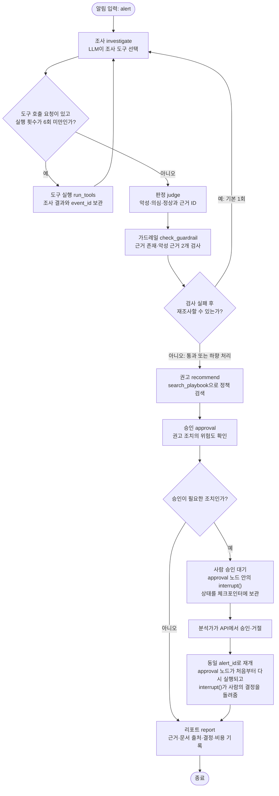

# 아키텍처: D1-13 에이전트 화이트보드 설계

이 문서는 현재 `src/soc/agent/`의 상태와 노드 함수, `docs/CONTRACT.md`의 도구 입출력을 바탕으로 **알림 한 건이 리포트가 되는 경로**를 정리한 설계도다. 그림은 구현 목표이며, 아래의 미구현 항목이 끝나기 전에는 동작하는 그래프로 해석하지 않는다. D1-13은 설계 문서 작성 단계이고, 코드 연결과 테스트는 D1-14 이후 작업이다.

## 1. 에이전트 흐름

그림의 `need_tools`는 코드의 `after_investigate()`, `guard_choice`는 `after_guardrail()`에 대응한다. 승인 노드는 조치가 안전해도 거치며, 위험한 조치일 때만 사람의 결정을 기다리는 설계다. `block_ip`, `kill_process`, `isolate_host`, `reset_password`가 현재 `DANGEROUS_ACTIONS`에 등록돼 있다.

`wait`, `analyst`, `resume`은 별도의 노드가 아니라 `approval` 노드 하나가 멈췄다가 이어지는 과정을 풀어 그린 것이다. 재개하면 `approval` 노드가 **처음부터 다시 실행**되므로, `interrupt()` 앞에는 DB 쓰기처럼 한 번만 해야 하는 일을 두지 않는다(03 문서 3장).

## 2. 상태와 노드별 입출력

`TriageState`는 알림별 작업 기록이다. `messages`는 LLM과 도구의 대화, `seen_event_ids`는 조사 도구가 실제로 돌려준 기록 ID, `playbook`은 PDF 검색 결과다. `trace`와 `guardrail_log`는 실행 경로와 검사 이력을 누적하고, `usage`는 토큰 사용량을 합산한다. 같은 알림은 `run_config(alert_id)`의 `thread_id`로 식별한다.

| 노드 | 하는 일 | 읽는 상태 | 쓰는 상태 | 연결 대상 | D1-14 운전 |
|---|---|---|---|---|---|
| 조사 `investigate` | 알림을 읽고 추가 조사 도구 호출 여부를 결정 | `alert`, `messages` | `messages`, `trace`, `usage` | `telemetry_tools()` | 📘 문서 담당 |
| 도구 실행 `run_tools` | 요청된 조사 도구를 실행하고 실제 `event_id`를 모음 | `messages`, `tool_rounds` | `messages`, `seen_event_ids`, `tool_rounds`, `trace` | `get_process_tree`, `get_process_activity`, `get_host_timeline` | 공동 연결 |
| 판정 `judge` | 구조화된 `Verdict` 생성 | `messages` | `verdict`, `trace`, `usage` | LLM | 공동 연결 |
| 가드레일 `check_guardrail` | 인용한 근거가 조회됐는지, 악성 근거가 2개 이상인지 검사 | `verdict`, `seen_event_ids`, `alert`, `guardrail_retries` | `guardrail`, `guardrail_log`, `trace`; 실패 시 `messages`, `guardrail_retries`, `verdict` | 규칙 검사 | 📘 문서 담당 (D2-3) |
| 권고 `recommend` | 알림·판정으로 정책을 찾고 조치 목록 생성 | `alert`, `verdict` | `playbook`, `recommendation`, `trace`, `usage` | `search_playbook(query, k)` | 🔍 기록 담당 |
| 승인 `approval` | 위험 조치면 사람의 결정을 기다림 | `recommendation`; 승인 요청에는 `alert`, `verdict`, 근거 ID도 사용 | `approval`, `trace` | `interrupt`, API, 체크포인터 | 🔍 기록 담당 (D2-4) |
| 리포트 `report` | 판정·권고·승인·출처·비용을 묶음 | `alert`, `verdict`, `guardrail`, `guardrail_log`, `recommendation`, `playbook`, `approval`, `tool_rounds`, `usage`, `trace` | `report`, `trace` | `triage-reports` 저장은 호출부 책임 | 공동 연결 |

분기 함수는 상태를 따로 읽는다. `after_investigate()`는 `messages`의 마지막 메시지와 `tool_rounds`를, `after_guardrail()`은 `guardrail`과 `messages`의 마지막 메시지를 읽는다.

조사 도구 결과의 `event_id`는 판정 근거 추적에, 플레이북 결과의 `source`와 `page`는 권고 출처 확인에 쓴다. `search_playbook`의 `score`는 검색 순위 결합 점수이며 판정 신뢰도 `confidence`와 다르다. 도구 선택은 `TELEMETRY_TOOLS`·`KB_TOOLS` 설정의 `mock` 또는 `real`을 따른다.

## 3. 갈림길 결정

1. **조사 반복:** 마지막 AI 메시지에 도구 호출이 있고 `tool_rounds < max_tool_rounds`이면 도구 실행 후 조사로 돌아간다. 기본 최대값은 6회다. 그 외에는 판정으로 간다.
2. **가드레일 실패:** 기본 설정 `guardrail_on_fail=retry`, `max_guardrail_retries=1`에 따라 한 번 더 조사한다. 재시도할 수 없거나 `downgrade` 설정이면 조회하지 않은 근거를 빼고 `malicious`를 `suspicious`로 낮추며 `needs_review=true`를 남긴 뒤 권고로 간다.
3. **승인:** `DANGEROUS_ACTIONS` 중 하나라도 권고되면 대상 호스트·판정·기법·근거 ID·조치를 사람에게 보여 주고 멈춘다. 승인·거절 결과를 받아 같은 `thread_id`로 재개한다. 해당 조치가 없으면 바로 리포트로 간다.
4. **출처와 결과:** 리포트의 `sources`는 `playbook`의 `source`에서 만들고, 승인 결정과 `trace`를 함께 남긴다. 승인 거절 시 조치 실행 여부와 리포트 상태의 세부 정책은 D2-4에서 확정한다.

## 4. 현재 구현 경계

- **구현됨:** `TriageState`와 노드 함수 틀, 도구 실행 및 실제 `event_id` 수집, 판정 노드, 가드레일 실패 시 재조사·하향 분기 함수, 리포트 생성, 기록 담당 조사 도구, 문서 담당 검색·Recall@3 측정.
- **미구현:** `graph.py`의 엣지 연결 `AG-3`, `investigate()`의 `AG-1`, `recommend()`의 `AG-2`, 가드레일의 실제 검사 `G-1`·`G-2`, 승인 중단·재개 `H-1`, Postgres 체크포인터 `H-2`.
- **실행상 한계:** 현재 `build_graph()`는 `NotImplementedError`를 내므로 Mermaid 그림을 코드에서 출력하거나 에이전트를 끝까지 실행할 수 없다. `BACKEND=real`이어도 `H-2`가 끝나기 전에는 체크포인터가 메모리를 사용한다. 위 승인 대기 경로는 아직 설계 목표다.

## 5. 배포 구성도 (2일차 이후)

로컬 Compose에는 OpenSearch, Postgres, Dashboards와 선택 API가 있다. k3s의 워커·시뮬레이터·Ingress·Job 연결은 인프라 단계에서 실제 리소스가 정해진 뒤 이 절에 추가한다.
